# Motion 设备端 V2.2.0 & APP V1.2.0 最终 PRD

版本：最终评审版  
日期：2026-11-04  
依据：本地 motion-demo-current 最新 Demo 及已确认产品规则。本文与页面右侧规则使用同一内容来源。

## 版本目标与范围

完善训练准备、AI跟练反馈、训练计次、床体安全控制、设备设置、常见问题与APP账号注销。设备端为1080×1920竖屏；页面与弹层沿用当前端主题和语言。

| 端 | 本次模块 |
| --- | --- |
| 设备端 | 训练准备、床体控制、AI训练、弹簧快捷切换、训练数据与次数、全局快捷设置、背景音乐音量、设置、常见问题、我的 |
| APP | 设置与练前准备偏好、常见问题、账号注销 |

产品内保留设备三Tab、APP四Tab及原有功能路径。Demo外侧左栏用于评审快速定位，右侧用于规则阅读与编辑。账号、训练反馈和设备状态使用Demo样例；摄像头与骨骼识别在本机运行。各模块说明对应数据来源。

## 主要操作流程

- 准备内容：读取管理后台动作库 → 已上传则按用户偏好展示完整或简洁引导 → 准备完成 → 动作开始页；未上传则直接进入动作开始页。
- 开始动作：用户点击开始 → 设备、训练会话、床体与锁定、媒体及适用AI识别条件检查 → 训练。
- 床体操作：打开全局面板 → 暂停训练并检查设备条件 → 确认折叠／展开或轨道解锁 → 等待设备状态回传。
- 注销账号：APP设置 → 账号与安全 → 影响说明并勾选 → 身份验证 → 最终确认 → 提交及结果。

## 训练准备

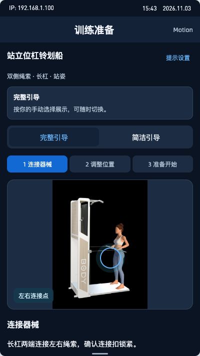

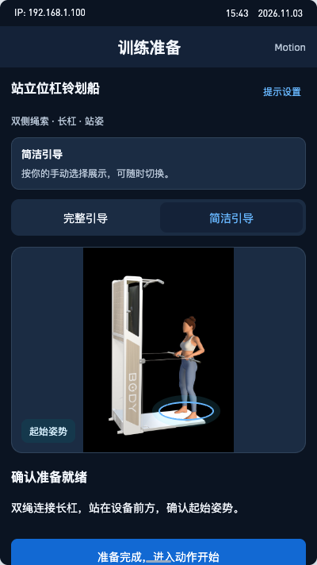

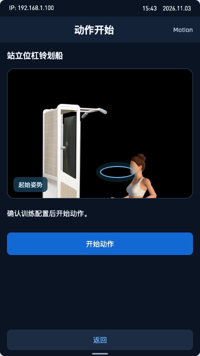

### 功能说明

训练准备提供完整引导与简洁引导，由用户手动选择。

### 页面与状态

完整引导：分步展示后台上传的连接器械、调整位置、准备开始等内容。简洁引导：集中展示后台维护的必要摘要与起始姿势。默认完整，后续按用户保存的偏好展示。

### 操作规则

准备页与设置→训练偏好均可手动选择完整／简洁，并保存偏好。完整切简洁立即显示摘要；简洁切完整从第一步开始。完整模式可前后回看，准备完成进入动作开始页；简洁模式确认后也进入同一动作开始页。进入动作开始页不等于启动训练。

### 异常与边界

后台确认当前动作未上传准备内容：直接跳过准备流程，进入动作开始页。加载期间显示等待状态，收到后台结果后判断内容是否已上传。请求失败显示重试并提供跳过准备、进入动作开始；服务端错误分类待确认。

### 相关联动

点击“开始动作”后检查设备连接、训练互斥、床体与锁定、媒体就绪及适用的AI识别条件，通过后启动训练。

### 验收与演示

右侧可直接切换完整／简洁；切换后刷新仍保留所选模式。后台内容模拟有已上传、未上传、加载中、加载失败；未上传直接展示动作开始页，可恢复已上传返回准备。页面所用图片和文字是模拟动作库返回内容。

### 数据来源与更新

正式内容由管理后台动作库上传并维护，按当前动作及语言读取对应准备媒体、步骤文字和简洁摘要。后台未配置与接口请求失败需明确区分。后台具体字段、发布状态、缓存有效期及刷新接口待对接确认；后台内容更新后按内容同步机制读取新内容，但不改变用户所选引导模式。Demo使用本地样例模拟后台返回。

### 状态保存与重置

保存用户手动选择的完整／简洁偏好。离开后重新进入完整模式从第一步显示，简洁模式保持简洁；切换动作、配置或内容版本不改变模式。偏好按账号保存；Demo使用固定模拟账号的本地存储。

### 适用条件与能力边界

适用于当前动作的完整／简洁准备内容。

## 床体控制

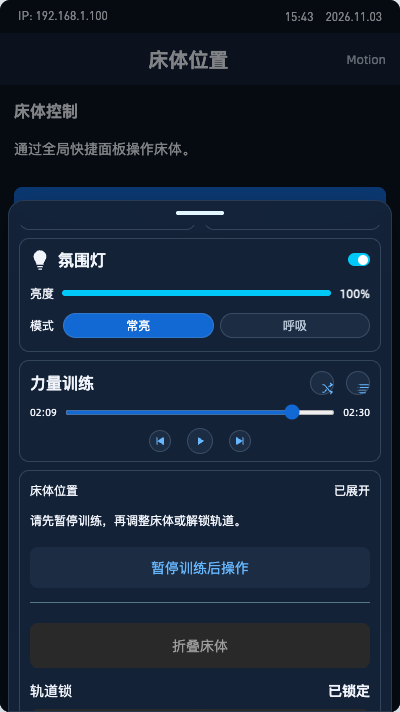

### 功能说明

设备全局快捷面板内提供床体位置与轨道锁。

### 页面与状态

已展开、已折叠、中途停止、移动中、未知分别展示；不满足条件直接禁用并说明原因。移动中始终提供停止入口。

### 操作规则

折叠／展开前确认床上无人且周围无遮挡。须明确暂停、连接有效、无其他活跃训练、推入轨道且锁定、状态新鲜。停止无需二次确认；中停仅继续原方向且再次确认。

轨道仅在完全展开、停止、暂停及连接正常时解锁；确认结果后开始倒计时，禁止重复延长。到0先显示重锁等待，回传确认才恢复锁定。

### 异常与边界

断连／未知禁止新命令；重连先同步不重放。确认期间条件变化需中止提交。停止结果未知不能显示已停止，应提示现场实体安全处理。锁定超时不允许恢复训练。

### 相关联动

移动、解锁、重锁未确认或未完全展开均禁止开练／继续。同设备同训练会话不误判冲突；其他会话训练时禁止操作。APP无床体控制入口。收起面板不停止移动、不取消硬件重锁。

### 验收与演示

当前入口直接定位床体卡；模拟场景支持断连、推入未到位、锁定超时。可暂停后折叠、停止、继续、展开、解锁。移动约4秒和解锁5秒仅为演示。

### 数据来源与更新

正式：位置、推入、连接、移动／停止结果、锁定及剩余时长来自设备／固件，关联设备及当前会话。命令受理不等于动作完成；旧状态不得作为操作凭据。回传字段、有效期及固件重锁时长待确认。Demo：共享本地床体状态与模拟延迟回传。

### 状态保存与重置

返回／收起不清空移动和解锁状态；重进先同步当前状态，不重置重锁倒计时。训练暂停不能解除其他安全条件。硬件负责自动重锁，不能依赖页面计时。

### 适用条件与能力边界

本期仅设备端。无可靠推入／位置／锁定证据时禁用，不能用用户确认代替传感器。

## AI 训练

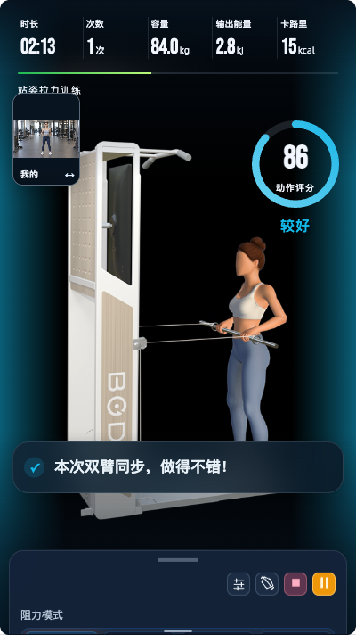

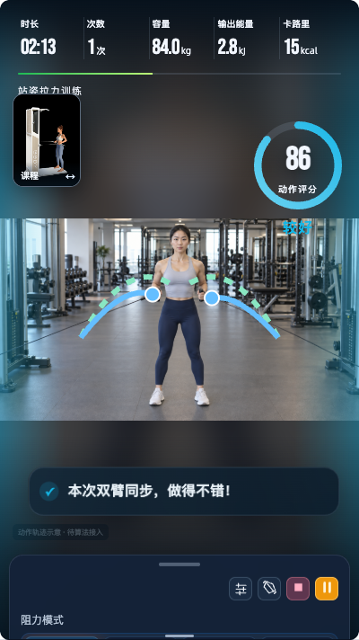

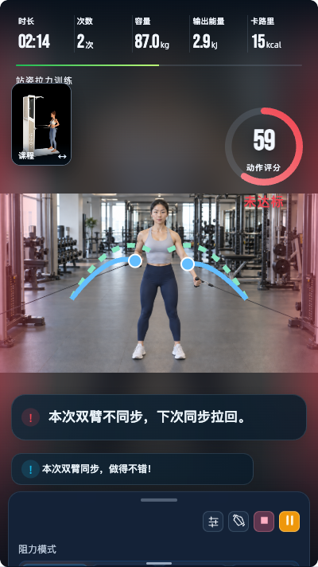

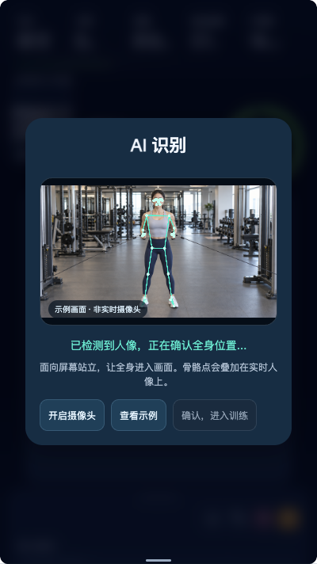

### 功能说明

单路全屏主画面、视频通话式小画框交换、圆环评分、柔和圆角纠错提示。

### 页面与状态

#### 主画面与小画框

设备按 1080×1920 视口排版。用户实时画面或课程示范占据整个训练背景，按源比例完整显示，不能为铺满裁掉身体；比例不匹配时使用同源柔化背景补齐。另一画面在上部小画框预览。点击小画框交换主次，不重建主播放器，不重置计时、次数、评分、视频进度或暂停状态。

所有适用训练页顶部统一为“时长、次数、容量、输出能量、卡路里”。次数为当前动作的有效完成次数，非AI沿用原计次规则，AI沿用算法结果；暂停、镜像、切换和抽屉均不计次。动作或组次切换按现有计数范围重置，不把不同动作次数混成一个指标。

小画框、数据、评分避开主画面身体关键区域。用户全屏时显示动作轨迹；课程全屏时不叠加用户轨迹。模拟轨迹为目标虚线、实际实线和关键点，仅验证视觉结构。真实提示必须按动作模板、体位、镜像方向、识别置信度及算法输出适配，识别不可靠时不绘制可信轨迹。

设置抽屉默认收起。展开仍保留全屏背景；右上角依次为多媒体、翻转、结束、暂停／继续图标。中央显示重量调节圆盘。床体控制统一从全局快捷面板进入。暂停和停止入口必须可达。

### 圆环评分与动效

评分使用算法分数、等级阈值与等级颜色。圆头进度环按0～100分比例绘制，中心显示大号分数，下方“动作评分”；圆环下方同步显示“完美、较好、良好、未达标”等级文字，等级由算法结果提供。动作完成后分数与环进度平滑更新；暂停冻结；无持续旋转或循环闪烁。完美浅绿、较好浅蓝、良好浅紫、未达标红，沿用原语义。

无法识别时中心“—”，上一有效进度保留并变灰；尚无有效分数时只显示底环。识别恢复后，下一有效评分才恢复数值和颜色。屏幕边缘与灯带反馈沿用同结果语义，故障及急停优先。

### 消息与语音

错误纠正提示按以下时序展示，普通鼓励提示采用轻量展示。

| 阶段 | 规则 |
| --- | --- |
| 放大入场 | 在主画面下方出现，文字清晰且完整，避开操作入口与身体关键区域 |
| 完整展示 | 入场完成后保持3秒；动画过程不扣减阅读时间 |
| 缩小收起 | 约350ms平滑过渡至左下角；使用常规字形 |
| 左下角队列 | 入队后独立保留5秒，再淡出；最多两条，最新在下，第三条挤出最早一条 |
| 同错误持续 | 当前已放大时不重播、不重复生成；已入队时续保留时间，不重新放大 |
| 不同错误接续 | 当前展示满3秒后，展示仍然有效的新错误；过期或已纠正错误不补播，不积压历史提示 |
| 安全类异常 | 设备故障、停止等安全状态优先于动作纠错，沿用原持续故障与停止规则，不受消息队列限制 |
| 暂停与后台 | 冻结动画及剩余阅读／队列时长，继续后恢复剩余时间，不重置完整寿命；不积累过期动作提示 |
| 纠正后复发 | 同一错误确实解除后再次出现，视为新错误；不能只依据同一条文案永久抑制 |

最大字号不小于本规范下限，放大提示最多两行；支持中文、英文和较长纠错。队列不手动滚动。底部使用紧凑磨砂圆角提示、状态图标、常规字体，强弱层级区分。Demo以动画入场约180ms＋完整保持3000ms＋缩小350ms实现；入队后5000ms＋约300ms淡出，演示动画参数可调，阅读时长不缩短。

屏幕纠错与语音使用动作库 AD 列对应用户语言的同一内容；中文与英文分别审核录音。Demo提供字幕文案校对，正式配音待交付。

| 排版项 | 设备端 |
| --- | --- |
| 弹出态 | 1080 宽设计稿 48～36px，按逻辑宽度换算 |
| 入队态 | 1080 宽设计稿 40～28px，按逻辑宽度换算 |
| 行高 | 字号 1.25 倍 |
| 字号适配 | 换算后遵循项目偶数设计字号及 2sp 步长 |

可见全角记 1，英文字母、数字、半角标点和空格记 0.5；单位参与计数。单条最多 32 等效字，每行最多 16 等效字，最多两行。先最大字号排两行，再减至下限。中文优先标点后换行并避开不合适的行首尾标点；英文优先词间，过长单词可断开，数字与单位尽量整体换行。不能压扁、滚动或省略关键文案。

发布前校验中英长度及真实排版；异常为空或下限仍溢出时，中文“请查看动作示范并调整姿势”，英文“Review the demonstration and adjust your form.”，英文待语言审核。语音使用同一兜底，记录异常供内容修订。

### 无法识别完整动作

人物未完整进入镜头时，评分显示“—”而非 0；保留上一有效评分对应的灰色圆环。尚无有效评分时只显示底环，不能假造上次评分。保留实拍及“无法识别完整动作”提示。

异常进入时清空旧消息，再显示“请让全身出现在镜头里，并确保镜头前没有遮挡”；状态持续不重复生成同一条。恢复时清空异常消息，下一有效结果才展示正常评分和反馈。

### 操作规则

点击小画框交换课程与实拍，不重置训练；用户主画面叠加轨迹，课程主画面不叠加用户轨迹。抽屉右上角多媒体、翻转、结束、暂停／继续可达。

### 异常与边界

相机／识别不可用时不伪造轨迹或评分；显示横线与识别提示。安全故障优先于动作纠错。

### 相关联动

顶部当前AI动作显示时长、次数、容量、输出能量、卡路里；有效次数以AI结果更新。全局计次的其他模式见左侧训练数据与次数。床体从全局面板控制。

### 验收与演示

当前小画框、抽屉和暂停可操作；评分／反馈模拟按钮可触发等级、未达标和无法识别。异常完整放大3秒，缩至左下角5秒，最多2条。动作评分算法、正式配音与灯控仍待接入。

### 数据来源与更新

正式：相机提供用户画面，课程资源提供示范；评分、动作完成、错误类型由算法返回并关联动作及会话，字幕／语音对应动作库当前语言内容。轨迹依赖模板、镜像和识别置信度。需过滤旧动作或旧会话的迟到结果，事件契约待确认。Demo：摄像头与骨骼预览使用本机采集和本地姿态识别；评分反馈与动作轨迹使用本地样例。

### 状态保存与重置

交换、翻转、打开抽屉不重置计时／次数／评分／播放位置；暂停与后台冻结反馈剩余时间。失识别保留上一有效环进度变灰，无历史仅底环；恢复后等待下一有效分数。跨动作重置遵循原训练范围。

### 适用条件与能力边界

仅设备AI训练。0～100分及等级阈值沿用算法约定。

### 2.5 灯带相关逻辑

硬件更新后移除独立氛围灯，灯带同时承担氛围效果和电机行程指示。

AI动作：灯带和屏幕左右两侧同时闪烁，使用对应评分的同一颜色、同一结果事件。AI期间停用原行程灯效对同一灯带的控制，避免叠加冲突。

非AI动作：灯带继续指示电机行程，逻辑与原版本一致。退出AI时清除未结束的评分闪烁，再恢复原行程指示。

### 评分颜色

完美 #70D62C；较好 #13B8E8；良好 #8B6CF0；未达标 #F04452。等级阈值不变，评分环、等级文字、屏幕两侧和灯带统一使用对应等级色。屏幕两侧渐变峰值不透明度提高至58%，向中间淡出，不遮挡人物。

无法识别不触发评分闪烁；暂停不触发新评分效果。安全告警与急停优先，结束后恢复当前动作对应灯效。新硬件不显示独立氛围灯设置，旧硬件按能力保留。实物灯色须硬件校准，Demo仅展示屏幕效果，不代表灯带硬件已接入。

### AI识别：实时全景与骨骼点

进入AI识别面板后，用户点击“开启摄像头”授权。展示摄像头实时完整画面，按源比例完整显示；骨骼点和连接线叠在人像上，与画面使用相同的缩放、居中及镜像变换。

识别中提示用户面向屏幕、全身入镜。持续检测到头部、躯干、双手及双脚后显示识别就绪，用户确认进入训练。缺少关键部位、被遮挡或人物离开时保留实时画面、清除不可靠骨骼点，并提示调整站位。用户确认前训练保持暂停。

权限拒绝提示允许访问后重试；无摄像头提供连接设备和示例入口；模型失败保留错误状态并支持重试。示例画面明确标注“示例画面 · 非实时摄像头”。

Demo通过本地摄像头采集视频，并使用随包的MediaPipe姿态模型在本机计算骨骼点；视频与骨骼数据不上传。浏览器版通过本地HTTP预览使用摄像头和模型。评分、纠错及动作轨迹样例仍使用模拟结果，正式动作算法由设备方案提供。

进入训练后复用同一摄像头画面与骨骼层；离开页面释放摄像头。切到后台暂停识别，回到前台重新确认当前人像位置。验证权限拒绝、无设备、全身／局部入镜、镜像对齐及离页释放。

## 训练数据与次数

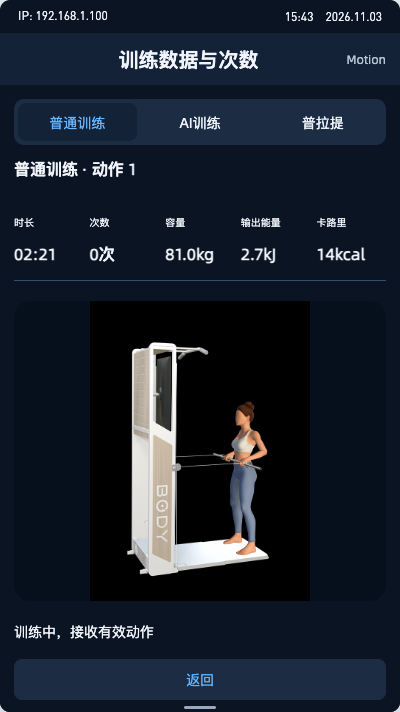

### 功能说明

所有适用训练顶部增加次数，统一为时长、次数、容量、输出能量、卡路里。

### 页面与状态

普通训练、AI训练、普拉提分别展示当前动作有效次数，单位次；确认尚无完成动作时显示0。无可用数据与0次区分，断连或未知不得伪造新数值。

### 操作规则

评审区域切换三种模式；模拟有效完成一次增加1，模拟重复事件不增加。暂停不计入新动作，恢复承接原次数。切动作开启新的演示动作计数。

### 异常与边界

正式有效计次事件与设备／算法契约核对；延迟或重复事件按会话、动作及事件标识处理。不能按视频循环或点击画面推断次数。

### 相关联动

AI、普通及普拉提共用五项展示规范，但有效动作判定各沿用现有模式。

### 验收与演示

分别切换三种模式验证+1、重复事件、暂停恢复、切动作。当前样例只模拟计次及数据连续性；容量、能量与卡路里使用固定样例。

### 数据来源与更新

正式：普通及普拉提由对应设备模式有效动作事件更新，AI由有效算法结果更新；数据绑定账号、设备、会话及动作。容量、输出能量和卡路里沿用现有计算来源。字段、去重标识和刷新频率待对接确认。Demo：三种模式独立本地样例。

### 状态保存与重置

暂停、翻转、换画面、展开设置不增加或清零次数。切组、切动作的累计／重置范围沿用原模式，不能把单动作和整节次数混为一谈；本页切动作仅演示新动作清零。刷新Demo不保存训练进度。

### 适用条件与能力边界

覆盖普通、AI、普拉提及计划／跟练中的对应动作。最低单边3kg、双边6kg不调整；指标来源待确认。

## 全局快捷设置

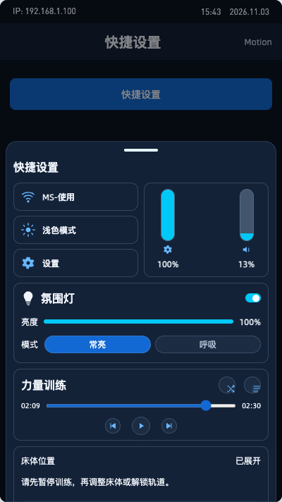

### 功能说明

局部上滑快捷面板，集中网络、主题、设置、亮度、音量、灯光与音乐。

### 页面与状态

面板高度约屏幕72%，保留上方原页面。左网络／主题／设置，右填充式竖滑杆，下方灯光、音乐、床体折叠卡。

### 操作规则

底部上滑或左侧评审入口打开，点击遮罩／把手收起。主题按钮表示点击后切换到的模式。滑杆更新百分比；灯光开关、常亮／呼吸、播放暂停、切歌和列表可演示。

### 异常与边界

设备未知能力不假定支持灯光。网络详情、音乐内容等Demo行为不代表连接真实网络或音频服务。

### 相关联动

亮度、音量、灯光与设置中心共享状态。床体卡可展开，完整操作规则见左侧“床体控制”。

### 验收与演示

从左侧打开可查看完整面板；调整数值后进入设置核对同步，收起返回原页面。音乐进度为模拟。

### 数据来源与更新

正式：网络／亮度／音量来自设备系统，灯光来自硬件能力与状态，音乐来自播放器。Demo：本地prefs、固定网络名和模拟曲目进度，不请求设备。正式系统控制及灯控接口待确认。

### 状态保存与重置

关闭面板不清空设置；刷新保留已保存设备偏好。音乐模拟进度不视为真实持久播放；收起不停止床体动作。

### 适用条件与能力边界

仅设备全局功能；设备初始深色中文。新旧硬件按能力展示灯光，未知不伪装支持。左栏入口为评审工具。

### 音乐音量入口

音乐卡片右下角提供背景音乐独立音量，完整规则见左侧“背景音乐音量”。

## 设置

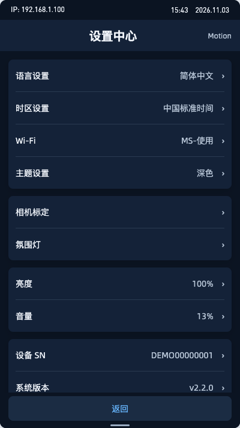

### 功能说明

补齐中英、深浅色切换及训练偏好，保留现有设置分组。

### 页面与状态

保留语言、时区、Wi-Fi、主题、标定、灯光、亮度、音量、SN与版本、单位、缓存、协议；训练偏好增加练前准备完整／简洁。

### 操作规则

点击条目进入对应详情；选择主题／语言即时应用当前设备新增页面与弹层；训练偏好提供两档。

### 异常与边界

硬件能力以设备返回结果为准；未接入的详情为静态演示。缓存清理不等同于清除训练账号数据。

### 相关联动

快捷面板与设置共用设备偏好；练前准备按用户选择展示完整／简洁引导，后台未上传则进入动作开始页。

### 验收与演示

可切换主题和语言并刷新核对；练前准备两档可选。其余原设置详情的真实系统行为未在浏览器实现。

### 数据来源与更新

正式：系统条目读取设备配置，SN／固件来自设备，练前准备偏好读取账号设置。系统能力、账号同步及版本接口待确认。Demo：本地prefs和模拟设备信息；准备偏好属于固定模拟账号。

### 状态保存与重置

主题、语言、亮度、音量本地保存；两端外观独立。账号训练偏好正式按账号保存；退出／切换用户不得继承他人个人偏好。

### 适用条件与能力边界

设备无注销入口。语言选项为简体中文和English。主题不改变媒体本身；每个详情继承当前端主题与语言。

## 常见问题

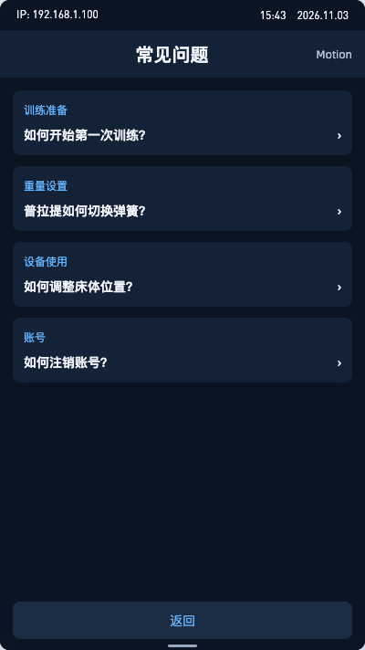

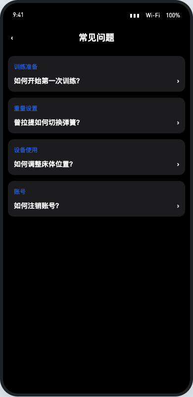

### 功能说明

个人中心提供“常见问题”入口。

### 页面与状态

列表展示分类和问题标题；详情展示分类、完整标题及富文本正文。设备端标题与底部返回固定，内容独立滚动。

### 操作规则

列表整项可点进入详情；正文独立滚动，返回恢复列表位置。

### 异常与边界

加载、空内容与失败分开；空“暂无常见问题”，失败“常见问题加载失败，请重试”；详情失败提供重试及返回。缺当前语言内容不静默显示其他语言，回退策略待确认。

### 相关联动

我的入口与本页同名；两端按各自样式展示同一内容语义。

### 验收与演示

增加本模块正常／空／失败演示按钮；可查看详情及返回。后台发布和缓存刷新尚未真实接入。

### 数据来源与更新

正式：后台已发布内容，含分类、完整标题、富文本、语言、排序及发布状态；只读取当前语言允许展示内容。刷新时机、缓存有效期及下线同步待确认。Demo：本地固定问题与状态切换。

### 状态保存与重置

详情返回保留列表位置；切语言重新读取对应内容；内容下线后的缓存处理须按后台契约，不无限保留旧内容。

### 适用条件与能力边界

设备与APP均适用。正式图片／链接沿用安全展示规范。

## 我的

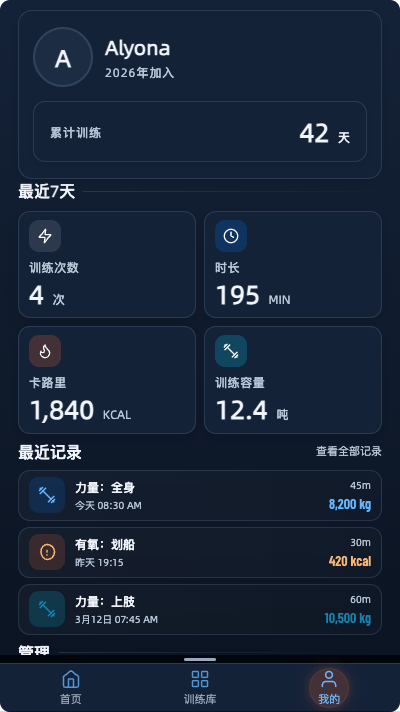

### 功能说明

个人中心提供“常见问题”入口。

### 页面与状态

保留用户数据、近期记录、计划和原管理入口。

### 操作规则

常见问题进入问题列表；原设置、计划、记录继续按原路径；退出登录沿用现有确认。

### 异常与边界

账号失效时禁止新个人操作；训练中保留必要停止／结束，安全结束后退出。

### 相关联动

常见问题详情规则见独立入口；APP注销位于设置→账号与安全。

### 验收与演示

核对入口文案和跳转；原记录、计划、设备设置可达；设备无注销。

### 数据来源与更新

正式：账号资料与训练记录来自当前登录账号服务，统计周期沿用原定义；不可混入前一账号数据。Demo：本地固定用户和训练记录。

### 状态保存与重置

切账号清理个人缓存；设备级外观与账号数据分别处理；退出不直接中断物理控制。

### 适用条件与能力边界

适用于设备个人中心。

## APP 设置

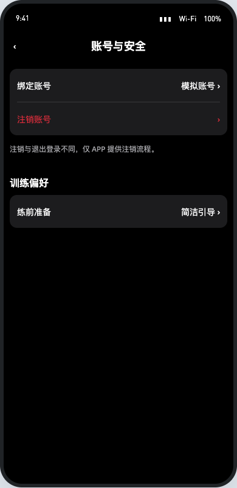

### 功能说明

设置保留账号与安全，并新增练前准备偏好；注销仅在APP。

### 页面与状态

当前Demo展示账号与安全及训练偏好；账号安全下可进入注销。

### 操作规则

点击注销进入影响说明；练前准备选择完整／简洁。

### 异常与边界

账号身份或偏好加载失败不使用上一用户记录。

### 相关联动

准备偏好仅由用户手动选择；后台动作库未上传内容则跳过准备流程，安全门禁仍保留。

### 验收与演示

可进入注销及修改准备偏好；当前Demo没有原生APP运行环境。

### 数据来源与更新

正式：绑定信息和偏好由当前账号服务提供，接口复用情况待确认。Demo：固定模拟账号、本地偏好，不发送验证码或真实注销请求。

### 状态保存与重置

账号偏好正式跨端同步语义一致；设备和APP外观独立。取消返回设置保留已提交偏好。

### 适用条件与能力边界

适用于APP设置，保留原体测、连接及四Tab导航。

## APP 账号注销

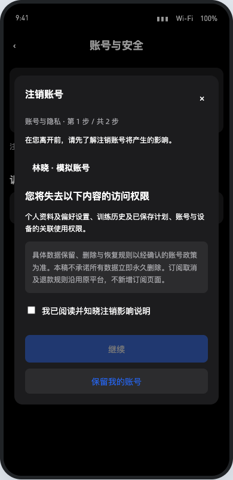

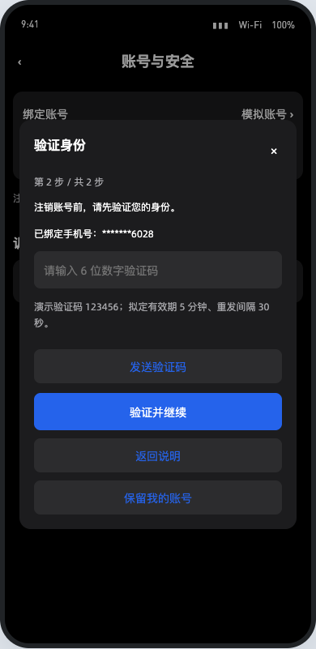

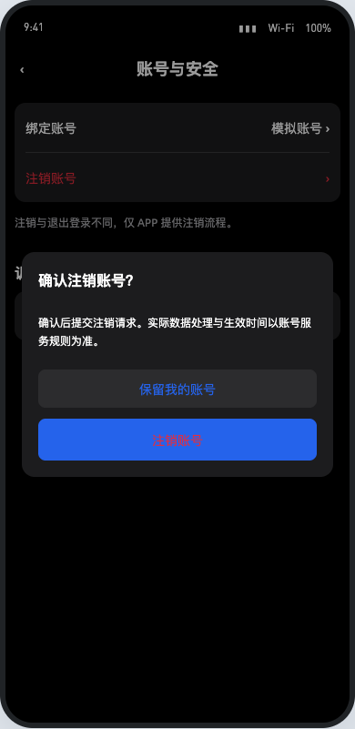

### 功能说明

补齐影响说明、验证、最终确认、处理中与结果。

### 页面与状态

### 影响说明与身份验证

入口“设置 → 账号与安全 → 注销账号”。第 1 步展示当前账号、影响说明及勾选：“我已阅读并知晓注销影响说明”；默认不勾，继续禁用。说明个人信息、训练数据和设备关联的访问影响；实际删除、保留、匿名化及恢复期限以确认政策为准。

“保留我的账号”回个人页；返回回账号与安全。订阅由原扣费平台处理。

第 2 步复用当前账号身份验证。国内显示绑定手机号仅末四位；海外邮箱保留 @ 前及域名前三位，其余遮挡，短地址不补造字符。只允许验证当前绑定渠道。

需求提议：验证码 6 位数字、5 分钟有效、30 秒重发；正式参数以账号服务安全规则为准。发送成功开始重发倒计时，失败不报成功；重发清空输入和旧错误、更新有效期。验证码 123456 只用于 Demo。

| 条件 | 页面提示 |
| --- | --- |
| 尚未发送 | 请先点击发送验证码 |
| 非 6 位数字 | 请输入6位数字验证码 |
| 错误 | 验证码错误，请重试 |
| 过期 | 验证码已过期，请重新发送 |
| 最终提交时验证失效 | 身份验证已过期，请重新获取验证码。 |

返回说明保留勾选，不沿用已通过验证。取消结果弹窗停留验证页，再次提交仍检查验证有效性。

### 最终确认、处理中与结果

最终确认无关闭叉号，背景不可操作底层页面；点击外部或系统返回可取消弹窗并停留验证页。保留账号回个人页；注销操作校验验证状态后提交。处理时显示“正在注销…”，所有操作禁用，外部／系统返回不关闭，防重复。

成功以服务端确认生效为准，清理登录态，显示“账号已注销”，返回登录。延迟审核则显示“注销申请已提交”，不能提前清理成已注销结果。失败说明原因、允许重试；结果未知先查询状态，不重复创建申请、不误报已完成。验证凭据与注销请求需关联，不能只相信客户端倒计时。

设备端没有注销入口。注销生效后未训练时清理个人会话并返回登录；训练中提示“当前账号已失效，请先结束训练。”，阻止新个人操作，保留停止／结束与必要安全控制；安全结束后退出。离线恢复先校验账号状态，不从旧缓存恢复个人操作。不能通过账号注销直接中断物理控制。

### 操作规则

默认不勾选，勾选后继续；复用绑定渠道验证；提交前最终确认。处理中禁重复操作。

### 异常与边界

验证码格式、错误、过期、发送失败分别提示；结果未知先查询，不重复创建申请。

### 相关联动

账号生效失效后设备安全退出，不直接停止物理控制。

### 验收与演示

Demo验证码123456，仅本地模拟；正式政策、验证参数和状态查询未接入。

### 数据来源与更新

正式：当前绑定渠道、验证码校验与注销结果均由账号服务确认。客户端倒计时不代表凭据有效；提交受理不等于已注销。数据保留／匿名化政策待确认。

### 状态保存与重置

返回保留说明勾选但不保留已通过身份验证；取消最终弹窗停留验证页；成功后清登录态。

### 适用条件与能力边界

适用于APP账号注销，安全参数以账号服务为准。

## 背景音乐音量

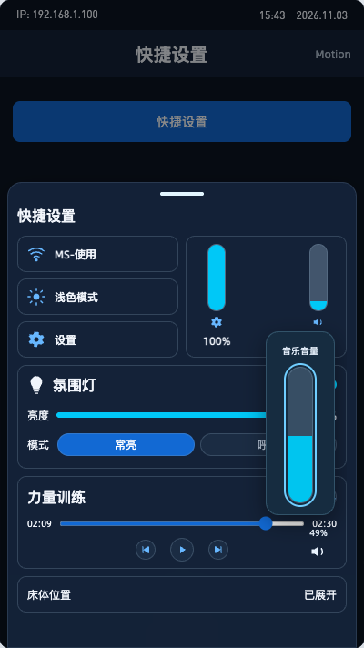

### 背景音乐独立音量

快捷面板音乐卡片右下角显示扬声器图标，音量百分比位于图标上方。点击图标展开竖向背景音乐音量滑杆，范围0～100%，由下向上增加音量，拖动实时更新；0%表示音乐静音。再次点击图标收起滑杆。

背景音乐使用独立音量值，调节仅作用于背景音乐播放器。课程视频、指导人声和提示音保持当前音量。

切歌、暂停／继续、收起面板及切换训练页面保留音乐音量；刷新或重新进入时恢复保存值。未播放音乐时可预设，播放后按保存值生效。

正式数据读取背景音乐播放器的独立音量，写入成功后同步控件；失败时保留上次生效值并提示重试。接口及实际音频通道接入待确认。Demo使用设备本地保存值，初始30%为演示参数；当前音乐播放与音量为模拟。

验收：在音乐卡片右下角打开滑杆并调整，核对视频音量保持不变；验证0%、100%、切歌、收起重开及刷新恢复。

## 弹簧快捷切换

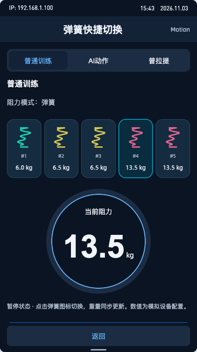

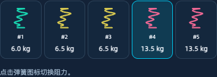

### 功能与入口

设备端所有支持弹簧模式的训练，统一在训练配置区展示横向弹簧图标选项，包括普通／自由训练、AI动作、普拉提及计划中的对应动作。左侧“弹簧快捷切换”用于直接查看统一控件；AI训练的配置抽屉中同样提供。

### 展示与操作

每项展示弹簧图标、颜色、阻力和编号，同重量项通过编号区分。点击切换选项，当前项高亮，重量圆盘同步更新。重复点击当前项保持当前配置；其他阻力模式显示其对应配置。

### 生效与异常

Demo在暂停状态允许切换；AI训练进行中提示先暂停。正式切换遵守设备已有安全条件，设备确认成功后更新生效值；断连、状态未知或切换失败保留上次生效值并提示原因。控制接口与安全条件待固件对接确认。

### 数据来源与保存

弹簧编号、颜色、阻力与可选范围读取当前设备配置；Demo使用6.0、6.5、6.5、13.5、13.5kg五个样例。当前选中值绑定训练会话，切换页面不创建额外设备命令。AI抽屉图标与重量圆盘共用现有阻力状态。

### 验收与演示

左侧入口可分别查看普通、AI、普拉提样式，点击弹簧验证高亮和重量同步；进入AI训练，展开配置抽屉并选择弹簧模式，暂停后点击图标切换。正式弹簧配置和指令回传未在浏览器接入。

## 发布前待确认事项

| 模块 | 待确认内容 |
| --- | --- |
| 动作库 | 准备媒体、步骤及摘要字段；语言和发布状态；缓存刷新规则；加载失败分类 |
| 训练数据 | 各模式计次事件、去重标识、会话与动作范围、刷新频率；现有容量、能量及卡路里数据来源 |
| AI | 等级阈值、置信度、轨迹模板、失识别事件与结果时序；正式中英文配音 |
| 硬件 | 推入、位置、移动、停止及锁定回传有效期；固件自动重锁时长；灯控能力与协议 |
| 常见问题 | 当前语言内容、富文本展示、发布下线、排序与缓存生效时机 |
| 注销 | 数据处理政策、验证码安全参数、即时或延迟生效、请求结果查询接口 |

## 验收口径

以各模块“验收与演示”所列场景验证页面与交互；正式发布需使用实际账号、设备、相机及后台内容验证数据联动。评分等级文字与圆环分数来自同一次结果，切换语言、暂停恢复及无法识别时保持一致。

本文件截图来自当前Demo实际页面。Demo的模拟数值与延迟用于演示交互，正式指标及设备状态以对应服务或固件返回为准。
